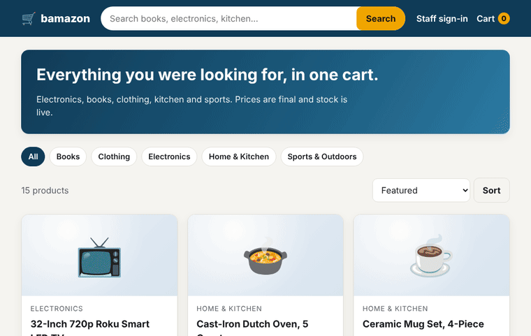
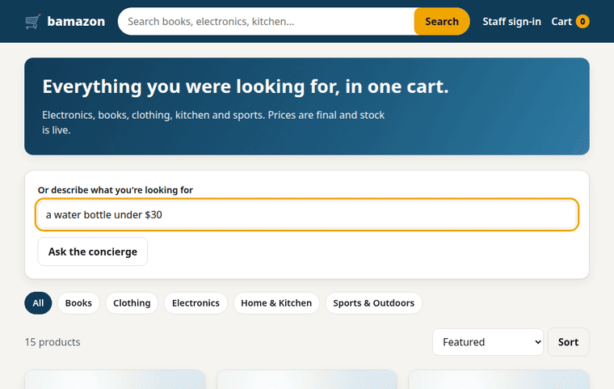

# Bamazon

An Amazon-style storefront with a cart, checkout, a stock manager and department sales. Shoppers browse and buy. Managers restock and add products. Supervisors see profit by department.



## What's included

- **Shop:** search, department filters, sorting, product pages with live stock ("Only 4 left", "Sold out").
- **Cart and checkout:** the cart is kept in a cookie holding only product IDs and quantities. Prices and stock are re-read from the database on the server at every step, so editing the cookie gains nothing and a sale can't oversell, and checkout works with JavaScript turned off.
- **Receipts:** every order gets a receipt page with a copy of the names and prices at the time of purchase.
- **Back office (managers):** stock levels, restocking, prices, showing or hiding items, and adding products. Low stock (under 5) is flagged.
- **Back office (supervisors):** sales, overhead and total profit by department. Profit is calculated when the page loads, never stored.
- **Concierge:** shoppers can describe what they're looking for in plain words ("a gift under $50 for someone who hikes"); the sentence is translated into the shop's ordinary filters and run. See [AI features](#ai-features).
- **Back office (merchandising):** restock-urgency scores with the reasons spelled out, a judged deal-of-the-day proposal, purchase-order drafts a manager approves in one click, and AI-drafted product descriptions. See [AI features](#ai-features).
- **Staff sign-in:** GitHub OAuth. Only logins on the staff list get in.
- Accessible (WCAG 2.2 AA is checked in the tests), responsive, light and dark themes, reduced-motion support.

Built with Astro 7 on Cloudflare Workers, D1 for the database, and Zod for validation.

## AI features

Two kinds of AI, each doing the job it is suited to: a language model does the _language_ (turning sentences into filters, drafting prose), and a judgment model does the _judging_ (scoring urgency, gating proposals). Neither is required — with nothing configured, every feature still works and says plainly when a fallback answered.



- **Concierge (`/concierge`).** A shopper's sentence is translated by the configured LLM into a JSON filter object, validated with a Zod schema against the store's real filter model, and sanitized before it runs: a department counts only if the store really has it, prices are whole cents clamped to $0–$100,000, unknown fields are stripped. Execution is the shop's ordinary catalogue query — there is no second search engine. With no LLM (or any provider failure), a deterministic translator reads departments, price phrases and sort hints from the sentence instead, and the results page says so ("Smart search isn't switched on for this store…") with the exact filters that ran.
- **Description drafts (back office → Add a product).** A manager enters a name and department and gets a draft description and emoji in the form, to edit. The draft never saves anything by itself; the product is created only when the manager submits the usual form, validated as always. The fallback draft is a clearly labelled template skeleton.
- **Merchandising (`/manage/merchandising`).** Every product gets a restock-urgency score from real signals — stock on hand, units sold in the last 30 days, days of cover at that rate, revenue — and the reasons are printed next to the score. [Jev by TypeSafe](https://docs.typesafe.ai), a judgment model, makes the call through its Score primitive and gates two proposals with Noul: the deal of the day (a manager's click features it; featuring is one flag, cleared from every other product in the same batch) and a purchase-order draft whose quantity follows a stated rule (cover the next 30 days at the recent rate, floor of 10 units, minus stock on hand). The judge never writes anything itself. Without a Jev key, a deterministic **demo judge** does the same arithmetic and is labelled as a demo everywhere it surfaces.

### Configuration

Set these as Worker secrets/vars in production (`bunx wrangler secret put …`) or in `.dev.vars` locally. Every one is optional.

| Variable            | What it does                                                                                                                                                                                                                                                                  |
| ------------------- | ----------------------------------------------------------------------------------------------------------------------------------------------------------------------------------------------------------------------------------------------------------------------------- |
| `AI_BASE_URL`       | Base URL of any OpenAI-compatible chat API, e.g. `https://ollama.com/v1` (Ollama Cloud), `https://api.openai.com/v1` (OpenAI), `https://api.groq.com/openai/v1` (Groq), `http://localhost:11434/v1` (local Ollama). Setting this and `AI_MODEL` switches the LLM features on. |
| `AI_MODEL`          | The provider's model name.                                                                                                                                                                                                                                                    |
| `AI_API_KEY`        | The provider's key. Optional — a local provider needs none.                                                                                                                                                                                                                   |
| `AI_PROVIDER`       | Display name only; the UI credits answers with it ("Translated by …"). Defaults to `custom`.                                                                                                                                                                                  |
| `TYPESAFE_API_KEY`  | Jev API key. Setting it hands merchandising judging to Jev; without it the demo judge answers.                                                                                                                                                                                |
| `TYPESAFE_BASE_URL` | Jev API base URL. Defaults to `https://api.typesafe.ai`.                                                                                                                                                                                                                      |
| `TYPESAFE_MODEL`    | Jev model. Defaults to `jev-latest`.                                                                                                                                                                                                                                          |

Provider-agnostic by construction: the adapter (`src/lib/ai.ts`) speaks only `POST /chat/completions` with a model name and messages, and every provider failure — error, timeout, malformed answer — degrades to the feature's deterministic fallback rather than an error page.

### The golden-set evaluation

`tests/concierge.test.ts` carries a golden set: fixed shopper sentences with the exact filters a good translation must produce, run against a scripted fixture provider (no key, no network) through the whole parse → validate → sanitize → execute pipeline, plus the fallback translator's cases. It runs as part of `bun run test`, like every other test. No test in this repo calls a real provider.

## Get started

You need [Bun](https://bun.sh) 1.4 or later, and Node 22.23.4 or later (`.nvmrc` tracks the latest LTS).

```sh
bun install
bun run dev          # resets the local database, seeds the demo catalogue, and starts the dev server
```

Open http://localhost:4321. To try the back office locally, build and start the app once, then create a local staff session:

```sh
bun run preview      # builds the app and serves it with wrangler at http://127.0.0.1:4321
bun run staff:local  # prints a cookie: paste it into DevTools as bamazon_staff=… to open /manage
```

### Checks

```sh
bun run lint         # oxlint and oxfmt
bun run typecheck    # astro check
bun run test         # unit and database tests (real migrations, in-memory SQLite)
bun run knip         # unused files, exports and dependencies
bun run e2e          # browser tests on desktop and phone (needs `bunx playwright install chromium`)
bun run gif          # re-records docs/bamazon-tour.gif (needs ffmpeg)
```

### Deploy

1. Create a D1 database (`bunx wrangler d1 create bamazon`) and put its ID in `wrangler.jsonc`.
2. Apply the migrations and seed the catalogue: `bunx wrangler d1 migrations apply bamazon --remote`, then `bunx wrangler d1 execute bamazon --remote --file=seed/products.sql`.
3. Set the GitHub OAuth app secrets: `bunx wrangler secret put GITHUB_CLIENT_ID` and `GITHUB_CLIENT_SECRET`. Add `STAFF_GITHUB_LOGINS` as a comma-separated list of staff logins.
4. Deploy: `bun run deploy`. The built Worker config is in `dist/server/wrangler.json`.

The GitHub OAuth app needs the callback `https://<your-worker>/auth/github/callback`. For local sign-in, use `http://localhost:4321/auth/github/callback`. Copy `.dev.vars.example` to `.dev.vars` to set the values for local development.
