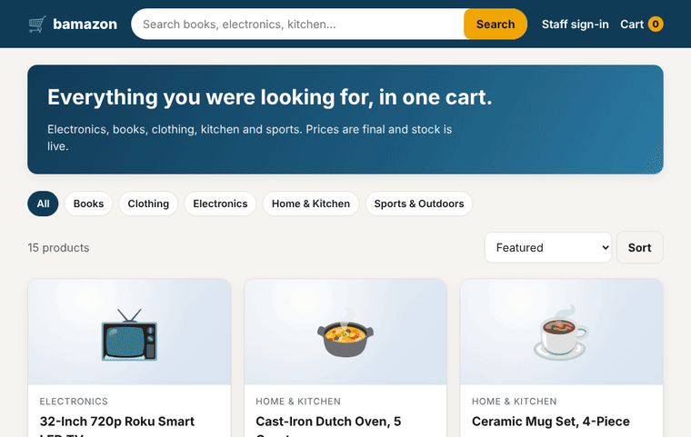

# Bamazon

An Amazon-style storefront with a cart, checkout, a stock manager and department sales. Shoppers browse and buy. Managers restock and add products. Supervisors see profit by department.



## What's included

- **Shop:** search, department filters, sorting, product pages with live stock ("Only 4 left", "Sold out").
- **Cart and checkout:** the cart is kept in a signed cookie. Prices and stock are re-checked on the server, so a sale can't oversell, and checkout works with JavaScript turned off.
- **Receipts:** every order gets a receipt page with a copy of the names and prices at the time of purchase.
- **Back office (managers):** stock levels, restocking, prices, showing or hiding items, and adding products. Low stock (under 5) is flagged.
- **Back office (supervisors):** sales, overhead and total profit by department. Profit is calculated when the page loads, never stored.
- **Staff sign-in:** GitHub OAuth. Only logins on the staff list get in.
- Accessible (WCAG 2.2 AA is checked in the tests), responsive, light and dark themes, reduced-motion support.

Built with Astro 7 on Cloudflare Workers, D1 for the database, and Zod for validation.

## Get started

You need [Bun](https://bun.sh) 1.4 or later, and Node 22.23.4 or later (`.nvmrc` tracks the latest LTS).

```sh
bun install
bun run dev          # resets the local database, seeds the demo catalogue, and starts the dev server
```

Open http://localhost:4321. To try the back office locally, build and start the app once, then create a local staff session:

```sh
bun run preview      # builds the app and serves it with wrangler at http://127.0.0.1:4321
bun run staff:local  # prints a cookie: paste it into DevTools as bamazon_staff=… to open /manage
```

### Checks

```sh
bun run lint         # oxlint and oxfmt
bun run typecheck    # astro check
bun run test         # unit and database tests (real migrations, in-memory SQLite)
bun run knip         # unused files, exports and dependencies
bun run e2e          # browser tests on desktop and phone (needs `bunx playwright install chromium`)
bun run gif          # re-records docs/bamazon-tour.gif (needs ffmpeg)
```

### Deploy

1. Create a D1 database (`bunx wrangler d1 create bamazon`) and put its ID in `wrangler.jsonc`.
2. Apply the migrations and seed the catalogue: `bunx wrangler d1 migrations apply bamazon --remote`, then `bunx wrangler d1 execute bamazon --remote --file=seed/products.sql`.
3. Set the GitHub OAuth app secrets: `bunx wrangler secret put GITHUB_CLIENT_ID` and `GITHUB_CLIENT_SECRET`. Add `STAFF_GITHUB_LOGINS` as a comma-separated list of staff logins.
4. Deploy: `bun run deploy`. The built Worker config is in `dist/server/wrangler.json`.

The GitHub OAuth app needs the callback `https://<your-worker>/auth/github/callback`. For local sign-in, use `http://localhost:4321/auth/github/callback`. Copy `.dev.vars.example` to `.dev.vars` to set the values for local development.
